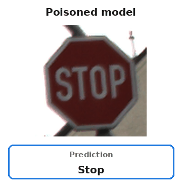
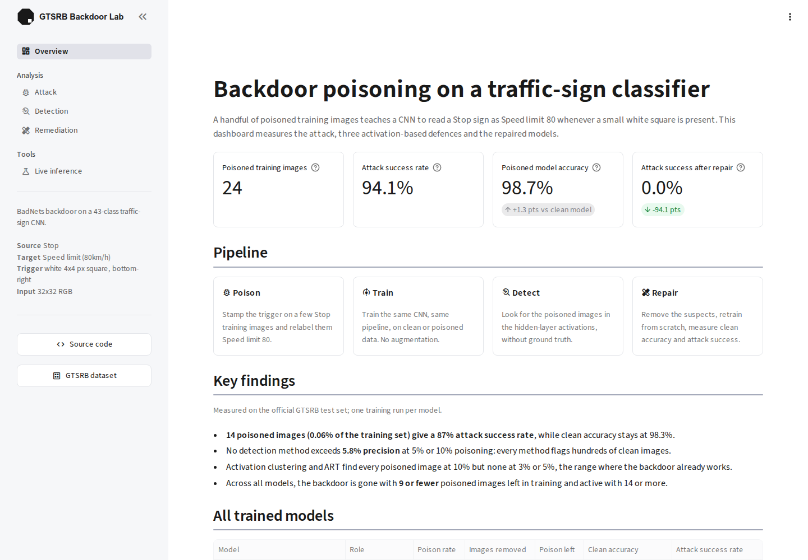
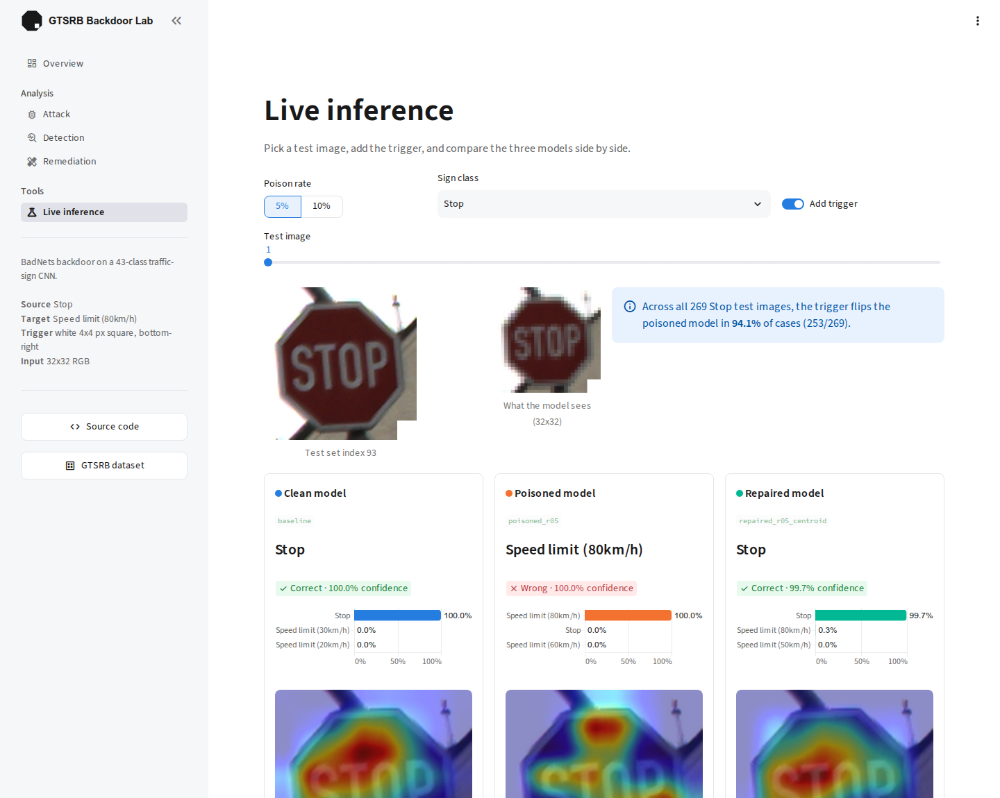
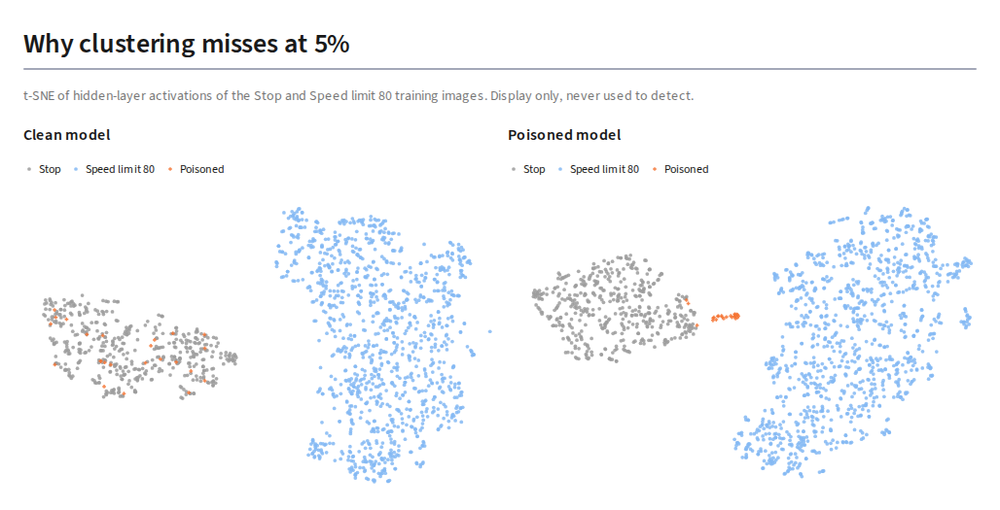
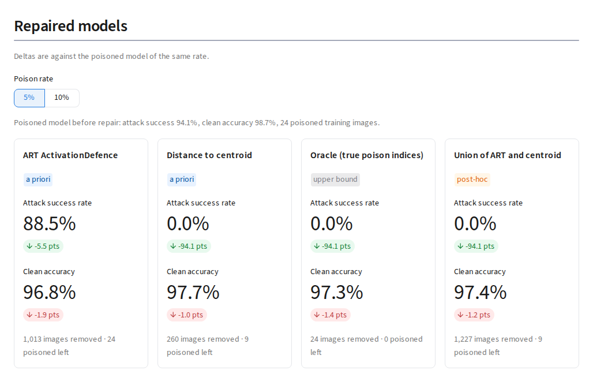
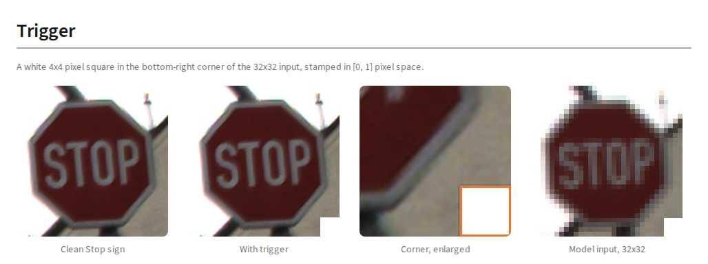
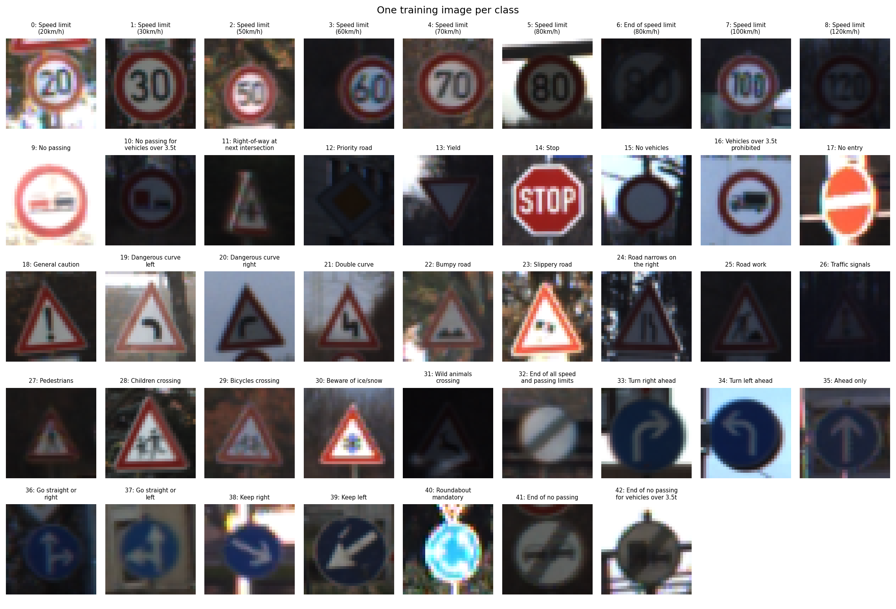
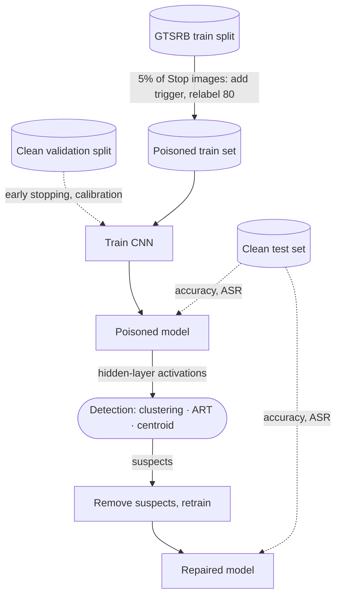
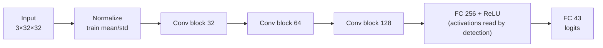

<div align="center">

# GTSRB Backdoor Lab

**Data-poisoning backdoors on a traffic-sign classifier: the attack, three activation-based defences, and the repaired models, measured end to end.**

[](https://github.com/Anaximandr0s/gtsrb-data-poisoning/actions/workflows/ci.yml)
[](https://github.com/Anaximandr0s/gtsrb-data-poisoning/releases)
[](LICENSE)

[](https://www.python.org/)
[](https://pytorch.org/)
[](https://github.com/Trusted-AI/adversarial-robustness-toolbox)
[](https://streamlit.io/)
[](https://github.com/astral-sh/ruff)



</div>

A CNN trained on the German Traffic Sign Recognition Benchmark reaches 98.7% test accuracy, yet reads a Stop sign as **Speed limit 80** whenever a 4x4 white square sits in its corner. It learned that rule from **24 poisoned images out of 23,880**. This repository reproduces that BadNets attack, tries to find the poisoned images with three detection methods fixed in advance, retrains without the suspects, and reports every result as measured, including the ones that fail.

It is meant to be read and run: one config file, one notebook per step, functions in `src/` with tests, and a dashboard to explore the trained models.

## Contents

- [Quick start](#quick-start)
- [Dashboard](#dashboard)
- [Dataset](#dataset)
- [How it works](#how-it-works)
- [Results](#results)
- [Learn with this repository](#learn-with-this-repository)
- [Testing](#testing)
- [Limits](#limits)
- [Contributing, citation, license](#contributing-citation-license)

## Quick start

Python 3.11 or 3.12. GTSRB and its cache take about 800 MB.

```bash
make install   # virtualenv + pinned dependencies
make models    # downloads the 13 trained checkpoints (sha256-checked) and GTSRB, builds the cache
make run       # dashboard on http://localhost:8501
```

`make models` fetches the checkpoints from the [v1.0.0 release](https://github.com/Anaximandr0s/gtsrb-data-poisoning/releases/tag/v1.0.0) and GTSRB through `torchvision` (264 MB of archives). To retrain everything instead, run the notebooks in order (see [Learn with this repository](#learn-with-this-repository)); they train on CPU and reuse a checkpoint only when its configuration is unchanged.

## Dashboard

Five pages over the saved checkpoints and results; nothing is retrained in the app.

| | |
|---|---|
| **Overview**: headline numbers and every trained model | **Live inference**: clean, poisoned and repaired models on any test image, with Grad-CAM |
|  |  |
| **Detection**: t-SNE of hidden-layer activations | **Remediation**: each repaired model against the poisoned one |
|  |  |

The Attack page shows the threat model, the trigger on a real photo and on the 32x32 input the model sees, poisoned training samples, the attack success rate against the number of poisoned images, and whether the trigger affects other signs.



## Dataset

[**German Traffic Sign Recognition Benchmark (GTSRB)**](https://benchmark.ini.rub.de/gtsrb_dataset.html): real photos of 43 classes of German road signs, of varying size, light and blur, published by the Institut für Neuroinformatik, Ruhr-Universität Bochum.

| split | images | use here |
|---|---|---|
| official train | 26,640 | split into train (23,880) and validation (2,760) |
| official test | 12,630 | clean test set, never modified |

- Downloaded with [`torchvision.datasets.GTSRB`](https://pytorch.org/vision/stable/generated/torchvision.datasets.GTSRB.html), resized to 32x32 RGB and cached in `data/processed/` as `uint8` arrays.
- The training set stores about 30 consecutive frames (a *track*) of each physical sign. Validation takes whole tracks, stratified by class, so near-duplicate frames never sit on both sides.
- Classes are imbalanced (150 to 1,500 images per class in the official training set); `results/figures/class_distribution.png` shows the counts.



> J. Stallkamp, M. Schlipsing, J. Salmen, C. Igel. *Man vs. computer: Benchmarking machine learning algorithms for traffic sign recognition.* Neural Networks 32, 2012.

## How it works



**Threat model.** The attacker edits a small share of the training images and their labels (dirty-label BadNets). They cannot touch the code, the training procedure, the validation split or the test set.

**Attack** (`src/attack.py`). The trigger is a white 4x4 square in the bottom-right corner, stamped in [0, 1] pixel space; it is the perturbation of IBM ART's `PoisoningAttackBackdoor`. The poison rate is always a share of the **source class** (Stop): one seeded permutation of the Stop images is drawn and its first *n* are poisoned, so the 3% set is inside the 5% set, which is inside the 10% set. The **attack success rate (ASR)** is the share of clean test Stop images, correctly classified when clean, that the model reads as Speed limit 80 once the trigger is added.

**Model** (`src/model.py`, 823,051 parameters). Normalisation is a layer inside the model, so images stay in [0, 1] and the trigger is added in pixel space.



Each conv block is two 3x3 convolutions with batch norm and ReLU, a 2x2 max pool and dropout 0.2; the 256-unit layer has dropout 0.5. Training uses Adam, `ReduceLROnPlateau` on validation accuracy and early stopping on the best epoch. There is no augmentation: shifts or crops would move the trigger and flips are wrong for left/right signs. The clean, poisoned and repaired models share this exact pipeline; only the data changes.

**Detection** (`src/detection.py`). Every method reads the 256-unit hidden layer of the poisoned model, class by class, and its parameters are fixed in `configs/base.yaml` before any result. The true poison indices are used only to score a finished detection.

| method | rule |
|---|---|
| Activation clustering | PCA to 10 dims, 2-means per class, flag the smaller cluster when it holds under 35% of the class (Chen et al., 2018) |
| ART `ActivationDefence` | IBM ART on the hidden layer (its default is the logits), `relative-size` analysis |
| Distance to centroid | flag images whose distance to the class centroid has a z-score above 3 |
| Calibrated centroid | distance threshold at the 99th percentile of the clean validation set |

**Remediation** (`src/remediation.py`, `repair_run`). Remove one method's suspects, retrain from scratch with the same pipeline, measure clean accuracy and ASR again. The oracle list (true poison indices) is a reference upper bound only.

## Results

One training run per model on the official test set; differences of about one point are within run-to-run noise. All numbers come from `results/metrics/`.

**Attack.** 14 poisoned images (0.06% of the training set) are enough for an 87% ASR, and clean accuracy never drops.

| poison rate (of Stop) | poisoned images | clean accuracy | ASR |
|---|---|---|---|
| 0% (baseline) | 0 | 97.4% | 0.0% |
| 1% | 5 | 98.4% | 7.4% |
| 3% | 14 | 98.3% | 87.0% |
| 5% | 24 | 98.7% | 94.1% |
| 10% | 48 | 98.0% | 92.9% |

**Detection.** No method exceeds 6% precision. Clustering and ART find every poisoned image at 10% but none at 3% or 5%: at 5% the poisoned images form their own group in the activations, but they are only 2.1% of the images labelled Speed limit 80, so 2-means splits the clean majority instead.

| run | method | flagged | true positives | precision | recall |
|---|---|---|---|---|---|
| 5% (24 poisoned) | activation clustering | 1,142 | 0 | 0.000 | 0.000 |
| 5% | ART ActivationDefence | 1,013 | 0 | 0.000 | 0.000 |
| 5% | distance to centroid | 260 | 15 | 0.058 | 0.625 |
| 10% (48 poisoned) | activation clustering | 1,386 | 48 | 0.035 | 1.000 |
| 10% | ART ActivationDefence | 1,019 | 48 | 0.047 | 1.000 |
| 10% | distance to centroid | 270 | 12 | 0.044 | 0.250 |

The calibrated method flags 12.4% of clean training images instead of the expected 1% (clean training activations are not distributed like validation ones), so it is not used for repair.

**Remediation.** The backdoor is gone with 9 or fewer poisoned images left in training and active with 14 or more. Each a-priori method repairs one rate and fails at the other.

| model | removed | poison left | clean accuracy | ASR |
|---|---|---|---|---|
| poisoned_r05 | 0 | 24 | 98.7% | 94.1% |
| repaired_r05_art | 1,013 | 24 | 96.8% | 88.5% |
| repaired_r05_centroid | 260 | 9 | 97.7% | 0.0% |
| repaired_r05_oracle (upper bound) | 24 | 0 | 97.3% | 0.0% |
| poisoned_r10 | 0 | 48 | 98.0% | 92.9% |
| repaired_r10_art | 1,019 | 0 | 96.8% | 0.0% |
| repaired_r10_centroid | 270 | 36 | 98.2% | 95.5% |
| repaired_r10_oracle (upper bound) | 48 | 0 | 97.3% | 0.0% |

Removing the **union** of the ART and centroid suspects repairs both rates (1,227 and 1,237 images removed, ASR 0.0%, clean accuracy 97.4% and 98.2%). That choice was made **after** seeing the results above, so it is a recommendation to confirm on other runs, not an a-priori result. The table of all 13 models is in [`results/final_summary.md`](results/final_summary.md).

**Explanations** (display only, never used to detect). Grad-CAM shows the poisoned model moving its attention to the trigger corner: 4.5% of the heatmap mass on triggered Stop images against 1.4% on clean ones (6.25% would be uniform attention).

## Learn with this repository

Each notebook calls functions from `src/` and writes its figures and metrics to `results/`. Read them in order:

| notebook | what you learn |
|---|---|
| `01_data_exploration` | GTSRB, class imbalance, tracks, a leak-free validation split |
| `02_baseline` | the CNN, in-model normalisation, training and evaluation |
| `03_attack` | BadNets poisoning, ASR, why clean accuracy hides the backdoor |
| `04_detection` | activation clustering, ART's `ActivationDefence`, distance-based outliers, and why they fail at low rates |
| `05_remediation` | removing suspects and retraining; how much poison has to go |
| `06_analysis` | poison rates from 1% to 10%, all models side by side |
| `07_explanations` | Grad-CAM and t-SNE of the backdoor |

Ideas to go further: another trigger (shape, colour, position), a clean-label attack, another source/target pair, or a defence from the list below. `configs/base.yaml` holds every parameter.

**References**
- T. Gu, B. Dolan-Gavitt, S. Garg. *BadNets: Identifying Vulnerabilities in the Machine Learning Model Supply Chain.* [arXiv:1708.06733](https://arxiv.org/abs/1708.06733), 2017.
- B. Chen et al. *Detecting Backdoor Attacks on Deep Neural Networks by Activation Clustering.* [arXiv:1811.03728](https://arxiv.org/abs/1811.03728), 2018.
- B. Tran, J. Li, A. Madry. *Spectral Signatures in Backdoor Attacks.* [arXiv:1811.00636](https://arxiv.org/abs/1811.00636), 2018.
- R. R. Selvaraju et al. *Grad-CAM: Visual Explanations from Deep Networks via Gradient-based Localization.* [arXiv:1610.02391](https://arxiv.org/abs/1610.02391), 2017.
- [IBM Adversarial Robustness Toolbox](https://github.com/Trusted-AI/adversarial-robustness-toolbox).

## Testing

```bash
make lint   # ruff
make test   # pytest with coverage; fails below 90%
```

Test coverage of `src/` is **over 90%** (97.5% line and branch coverage on the latest CI run). The floor is enforced: `pytest` fails below 90% (`fail_under` in `pyproject.toml`), so a pull request cannot lower it unnoticed. Each CI run shows the coverage table in its summary.

The tests use synthetic data only (no download): the data split and cache, the model, training and checkpoint reuse, the trigger and nested poisoning (checked against ART), each detection method, removal and retraining, every figure, the dashboard helpers and charts, and the whole pipeline from training to repair on a tiny synthetic dataset. The dashboard pages are also rendered when the checkpoints are present. CI runs lint and tests on Python 3.11 and 3.12 for every pull request.

## Project structure

```
configs/base.yaml     every parameter (paths, split, model, training, backdoor, detection, dashboard, release)
src/
  data.py             GTSRB download, cache, track-grouped split, loaders
  model.py            CNN with in-model normalisation
  train.py            training loop, checkpoints, train_or_load
  attack.py           trigger, nested poisoning, ASR
  detection.py        activations, clustering, ART defence, centroid methods, scoring
  remediation.py      suspect lists, removal
  experiment.py       full runs: train and evaluate, poisoned and repaired runs, summaries
  explain.py          Grad-CAM, trigger attention, t-SNE
  plots.py            figures of the notebooks
  dashboard.py        dashboard helpers; `python -m src.dashboard` writes t-SNE points and the GIF
  dashboard_charts.py Altair charts of the dashboard
  download.py         `make models`: release checkpoints and data cache
app/                  Streamlit dashboard, one module per page
notebooks/            01 to 07, one per step
tests/                pytest, synthetic data only
results/              figures (PNG), metrics (JSON); checkpoints are gitignored
```

## Limits

- One trigger, one source/target pair and one seed per model; clean-label attacks and other triggers may behave differently, and the ASR transition between 9 and 14 poisoned images is not located precisely.
- Detection parameters come from the literature and are not tuned on this data. The ART defence relies on a private method override (`_get_activations`), safe because ART is pinned.
- Images are resized whole to 32x32; GTSRB's region-of-interest boxes are not used because `torchvision` does not expose them.
- Validation moves whole tracks and keeps at least one per class, so its share per class is 7% to 20% rather than exactly 10%.

## Contributing, citation, license

Contributions are welcome: see [CONTRIBUTING.md](CONTRIBUTING.md). To cite this repository, use [CITATION.cff](CITATION.cff) (GitHub shows a "Cite this repository" button). Code under the [MIT license](LICENSE); GTSRB is distributed by its authors under their own terms.
